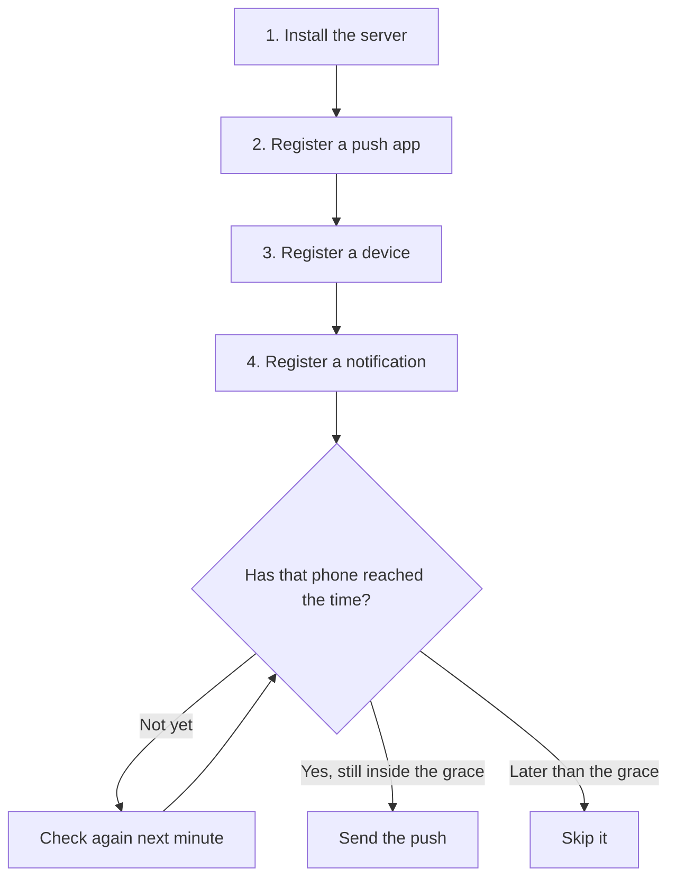
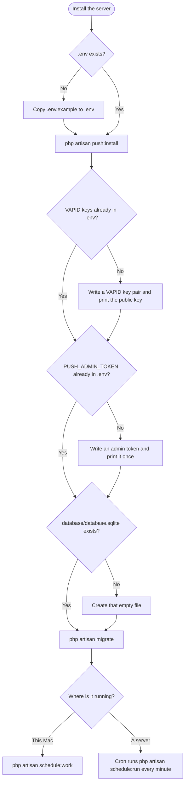
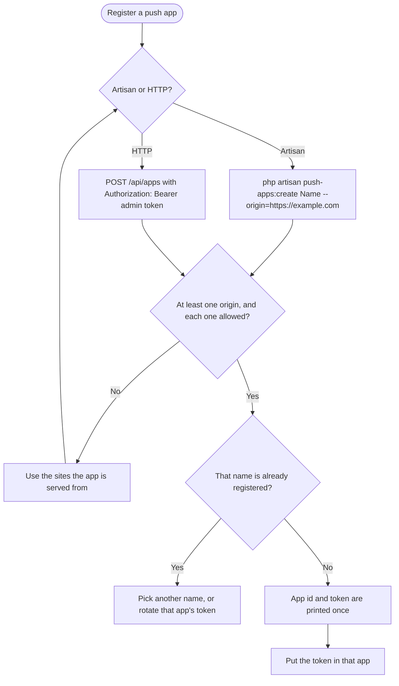
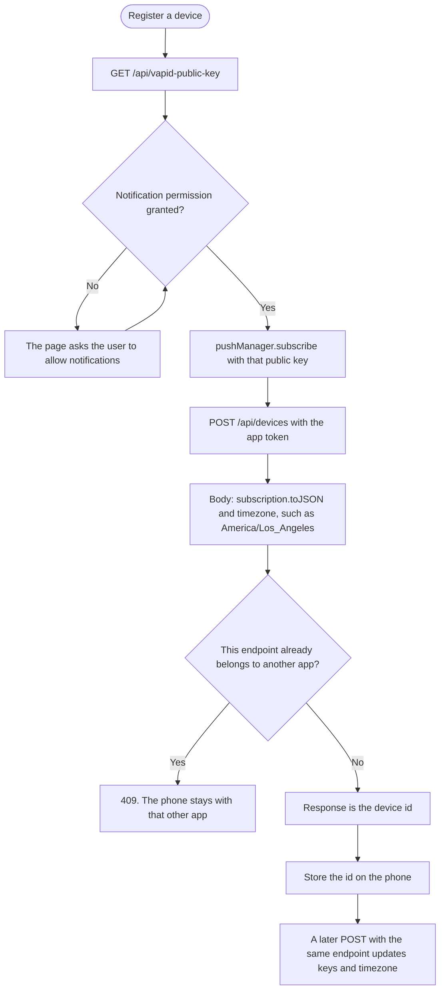
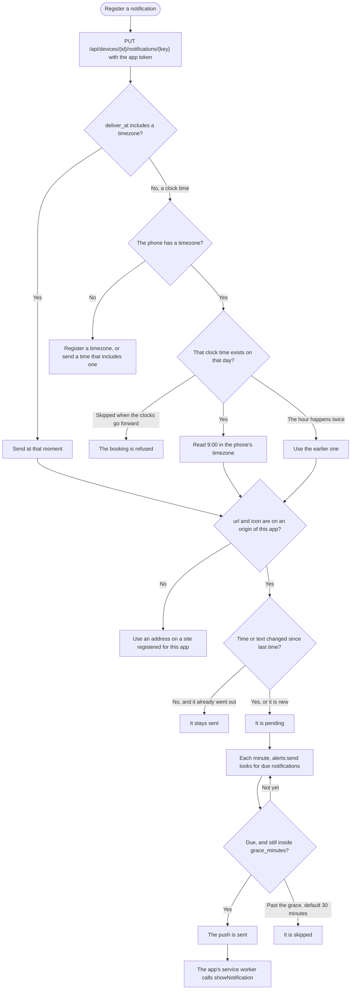

# Set up PWA Push

Herd serves this folder at <http://pwa-push.test>. Do these four steps in order. The server does not know why a reminder exists. The app decides the time and the words, and this server delivers them.



## 1. Install the server

`push:install` writes a VAPID key pair and an admin token into `.env` when they are missing. The public key is shared by every app. The admin token is only for registering apps.



On this Mac, leave `schedule:work` running. It sends anything that is due, once a minute. On a server:

```bash
* * * * * cd /path/to/pwa-push && php artisan schedule:run >> /dev/null 2>&1
```

## 2. Register a push app

Give every origin the app is actually served from, including `http://localhost` while you are developing. `http` is only for localhost, `127.0.0.1`, `::1`, and hosts ending in `.test`. The printed token goes into that app. It is not shown again.



Artisan:

```bash
php artisan push-apps:create "Dosage Helper" \
  --origin=https://example.com \
  --origin=http://localhost:5173
```

HTTP, with the admin token:

```bash
curl -X POST http://pwa-push.test/api/apps \
  -H "Authorization: Bearer $PUSH_ADMIN_TOKEN" \
  -H "Content-Type: application/json" \
  -d '{"name":"Worknote","origins":["https://worknote.example","http://localhost:5174"]}'
```

`php artisan push-apps:list` lists apps. `php artisan push-apps:rotate "Dosage Helper"` replaces a token. A token only lets that app register its own phones and its own notifications.

## 3. Register a device

The page asks for notification permission, subscribes with the public key, then registers the phone. Store the returned device id on the phone. The same call again updates the keys and the timezone, and returns the same id.



```http
POST /api/devices
Authorization: Bearer {app token}

{
  "timezone": "America/Los_Angeles",
  "subscription": {
    "endpoint": "https://...",
    "keys": { "p256dh": "...", "auth": "..." }
  }
}
```

Leaving `timezone` out keeps the one already stored. `DELETE /api/devices/{id}` removes the phone.

## 4. Register a notification

The key is yours (`expiry`, `time-09:00`, `2026-10-12T17:00`). Putting the same key again replaces it. If the time or the text changed, it will send again. If nothing changed, a notification that already went out stays sent.

`deliver_at` can be a moment that already includes a timezone, such as `2026-10-12T16:00:00Z`, or a clock time with none, such as `2026-10-12T09:00:00`. A clock time is read in the phone's timezone, so 9:00 is sent when that phone reaches 9:00. When the phone's timezone changes, a waiting clock time moves with it. A time that already includes a timezone stays at that moment.



```http
PUT /api/devices/{id}/notifications/{key}
Authorization: Bearer {app token}

{
  "deliver_at": "2026-10-12T09:00:00",
  "title": "Dosage Helper",
  "body": "Your bolus could be wearing off.",
  "url": "https://example.com/",
  "icon": "https://example.com/icons/icon-192.png",
  "tag": "expiry",
  "grace_minutes": 30
}
```

`url` and `icon` have to be on an origin you registered for that app. `grace_minutes` defaults to 30.

`DELETE /api/devices/{id}/notifications/{key}` cancels one. `DELETE /api/devices/{id}/notifications` cancels all of them for that phone. When the user logs a dose or saves a note, the app cancels or replaces the pending notification. This server cannot see that happen until the app tells it.
